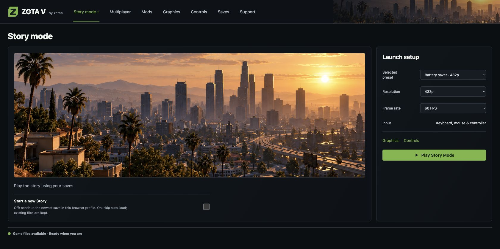

# ZGTA 5

**1.1 beta 1**

### By zema · zemabinks

**Solo Story · Free Roam · Private Multiplayer — Join or Create.**

Your own matching prepared game files are required. No commercial game content is included.

**[Download 1.1 beta 1](https://github.com/zemabinks/ZGTA-V/releases/tag/v1.1-beta.1)** · **[Install and update](docs/START-HERE.md)** · **[What's new](docs/RELEASE-NOTES-1.1-beta1.md)** · **[Play guide](docs/PLAY-GUIDE.md)**

## Start screens

| iOS app | Browser / Mac launcher |
|---|---|
|  |  |

[See the full iOS and browser gallery](docs/INTERFACE-PREVIEWS.md).

## Downloads

| Platform | Package | Status |
|---|---|---|
| iPhone / iPad — iOS / iPadOS 15.0+ | [1.1 beta 1 IPA](https://github.com/zemabinks/ZGTA-V/releases/download/v1.1-beta.1/ZGTA-V-Build109-VoiceDistance-TrollStore.ipa) | Owner-tested on iPhone 15 Pro with TrollStore. Other installation routes remain experimental. |
| Mac | [1.1 beta 1 DMG](https://github.com/zemabinks/ZGTA-V/releases/download/v1.1-beta.1/ZGTA-V-Build109.1-Mac.dmg) | Mac browser voice/gameplay tested; package checks pass. New109.1 drag-install not repeated; Apple Silicon untested. Ad-hoc signed, not notarized. |
| Mac / Linux browser | [1.1 beta 1 ZIP](https://github.com/zemabinks/ZGTA-V/releases/download/v1.1-beta.1/ZGTA-V-Build109-Browser-Mac-Linux.zip) | Requires installed Python 3.9+ and a compatible browser. Linux gameplay untested. |
| Windows x64 | [1.1 beta 1 ZIP](https://github.com/zemabinks/ZGTA-V/releases/download/v1.1-beta.1/ZGTA-V-Build109-Windows-x64.zip) | Bundled Python; Windows execution untested. |
| Android | [1.1 beta 1 Termux ZIP](https://github.com/zemabinks/ZGTA-V/releases/download/v1.1-beta.1/ZGTA-V-Build109-Android-Termux.zip) | Experimental browser version; no APK. Android execution untested. |

Read the **[installation guide](docs/START-HERE.md)** before downloading. The Mac launcher includes Python and requires Chrome plus your compatible game files. Sileo users can add **[Zema’s Repo](https://zemabinks.github.io/repo/)**. Installer **1.1~beta1** delivers the unchanged owner-tested Build 109 IPA through the public download URL. AppSync is experimental. Keep your existing app, game files and saves when updating; previous releases remain available.

## What's new in 1.1 beta 1

- Proximity voice between iPhone and browser multiplayer players, using the existing microphone and speaker controls.
- Voices become progressively quieter with distance and silent beyond 35 metres; movement changes are smoothed.
- Microphone and nearby-voice mute are separate from game audio.
- Matching iOS109, browser109 and Mac 109.1 downloads preserve your existing game files and data.

The building-rendering fixes, independent memory controls, integrated browser navigation and LAN browsing from beta3 remain included. This voice update makes no new device-performance claim.

## Guides

- [Install and update](docs/START-HERE.md)
- [Mods, vehicle previews and graphics](docs/PLAY-GUIDE.md)
- [Host or join a lobby](docs/PLAY-GUIDE.md#private-multiplayer)
- [Remote play with Tailscale](docs/REMOTE-PLAY.md)
- [Back up saves](docs/PLAY-GUIDE.md#back-up-saves)
- [Report a problem](docs/TEST-REPORT.md)

This remains a beta. Reduced-memory behavior has not been benchmarked on a physical 3 GB iPhone SE2020; stable 60 FPS is not promised. Private LAN/Tailscale play is supported, with no worldwide server directory. See [verification and remaining limits](docs/VERIFICATION.md).

## Optional hosting tools

Normal hosting uses **Multiplayer → Create a lobby** in ZGTA 5 and needs no extra download.

[Mac relay controls 1.1](https://github.com/zemabinks/ZGTA-V/releases/download/v2.0.0-beta.3/ZGTA-V-Relay-Controls-1.1.zip) are for a Mac that should keep a standalone multiplayer relay available while GTA is closed, including managed ZRemote setups. The relay forwards multiplayer traffic; the game runs on the players' devices. The Mac must stay awake and logged in. See [optional relay setup](docs/PLAY-GUIDE.md#optional-standalone-mac-relay).

## Source and credits

[Build information](docs/DEVELOPMENT.md) · [Source audit](docs/SOURCE-AUDIT.json) · [License](LICENSE) · [Native source license](native-port/LICENSE) · [Third-party notices](native-port/engine-lan/THIRD_PARTY_NOTICES.md)

The [versioning guide](docs/VERSIONING.md) explains the naming transition. Existing tested artifacts and their download filenames are retained.

Current product naming is **ZGTA 5 — 1.1 beta 1**; Sileo uses `1.1~beta1`. The signed application downloads are unchanged legacy Build 109/109.1 artifacts. Their older embedded short version is retained; this naming update is not a new gameplay build. New browser styling is being reviewed privately.
