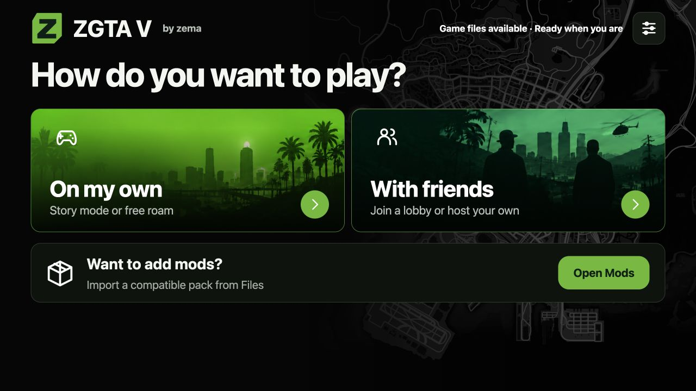

# ZGTA V 2.0 beta

### By zema · zemabinks

Solo Story, Free Roam, and Private Multiplayer. **Your own matching prepared game files are required; no commercial game content is included.**

**[Download 2.0 beta](https://github.com/zemabinks/ZGTA-V/releases/tag/v2.0.0-beta.1)** · **[Start here: installation guide](docs/START-HERE.md)** · **[Add Zema's Sileo Repo](https://zemabinks.github.io/repo/)**

## Pick your platform

| Platform | Package | Status |
|---|---|---|
| iOS with compatible TrollStore / TrollStore Lite | [Native IPA](https://github.com/zemabinks/ZGTA-V/releases/download/v2.0.0-beta.1/ZGTA-V-Build91-Archive-Access-TrollStore.ipa); Sileo installer also available | Beta; tested with TrollStore on a RootHide iPhone |
| Windows x64 | [Windows ZIP](https://github.com/zemabinks/ZGTA-V/releases/download/v2.0.0-beta.1/ZGTA-V-Build92-Windows-x64.zip) with bundled Python | Alpha; hardware execution/gameplay need community testing |
| Mac / Linux | [Mac/Linux ZIP](https://github.com/zemabinks/ZGTA-V/releases/download/v2.0.0-beta.1/ZGTA-V-Build92-Browser-Mac-Linux.zip) using Python 3.9+ | Beta; macOS host checked, Linux/gameplay testing pending |
| Android | [Termux ZIP](https://github.com/zemabinks/ZGTA-V/releases/download/v2.0.0-beta.1/ZGTA-V-Build92-Android-Termux.zip) | Experimental alpha, not an APK; GPU compatibility often limited |

**[Full installation instructions](docs/START-HERE.md)** explain game-folder layout, first launch, updates, local networking, saves, mods, controls and troubleshooting. An ordinary retail GTA install folder alone does not satisfy the prepared mirror format. This release does not provide a retail-game converter, native Windows game.exe or Android APK.

## Play and setup

- **Solo Story**
- **Free Roam**
- **Private Multiplayer — Join or Create**
- Saves, compatible mods, graphics settings, and controller support.

See the guide for [iOS installation and other sideloading options](docs/START-HERE.md#2-iphone--ipad), [hosting and joining](docs/START-HERE.md#playing-with-friends), [importing mods](docs/START-HERE.md#importing-mods), and [changing graphics](docs/START-HERE.md#graphics).

This is a beta. Windows, Linux, Android, and two-device multiplayer still need hardware gameplay testing. [Detailed test status](docs/VERIFICATION.md).

Found a problem? [Report it here](docs/TEST-REPORT.md).

## Source and credits

Source is included for the native iOS app, browser host, and multiplayer components. A fresh native build requires additional generated engine/shader inputs and has not yet been validated. See the [source audit](docs/SOURCE-AUDIT.json) and [verification notes](docs/VERIFICATION.md).

Upstream authorship and licenses remain in [LICENSE](LICENSE), [native-port/LICENSE](native-port/LICENSE), the bundled Licenses resources, and [third-party notices](native-port/engine-lan/THIRD_PARTY_NOTICES.md).
