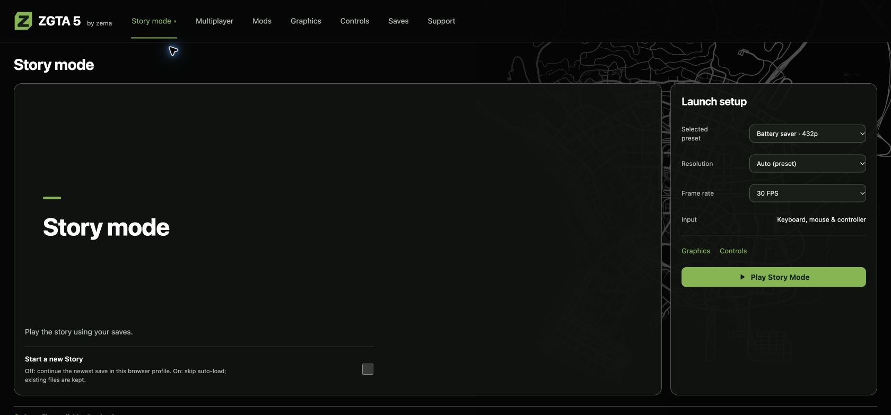
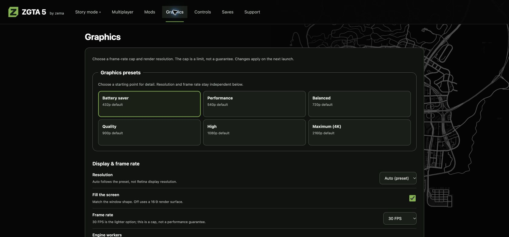
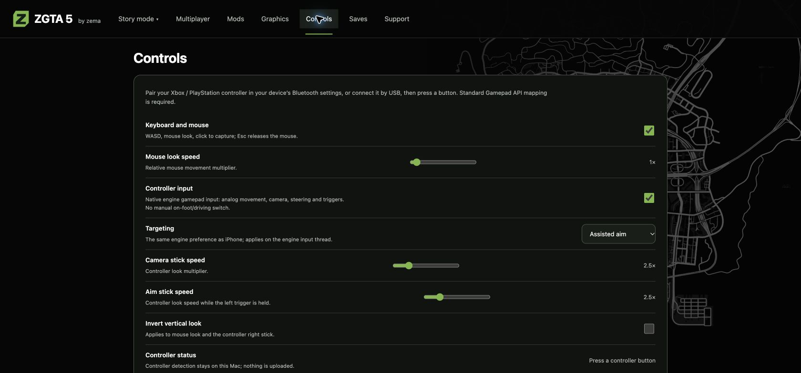
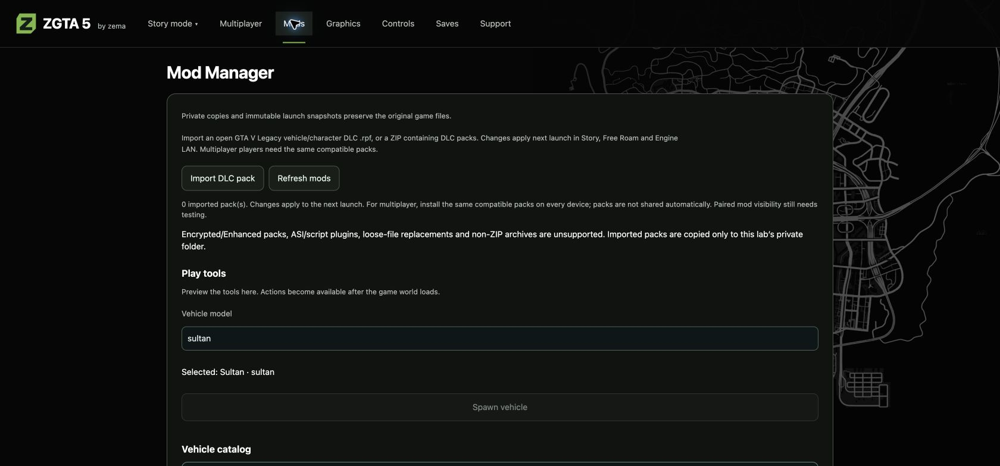
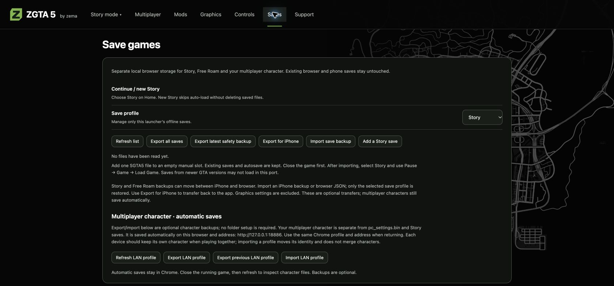
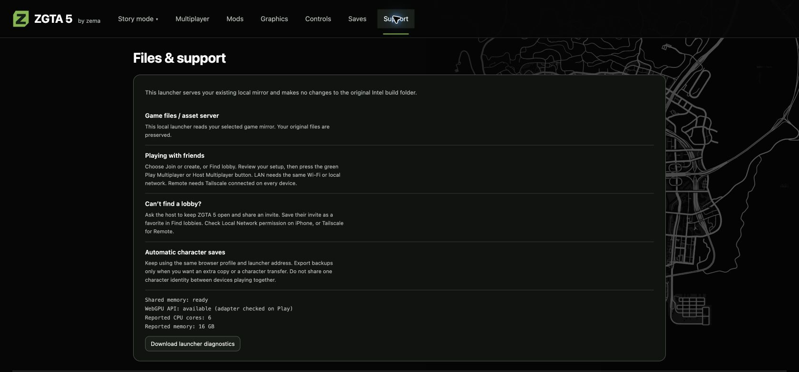
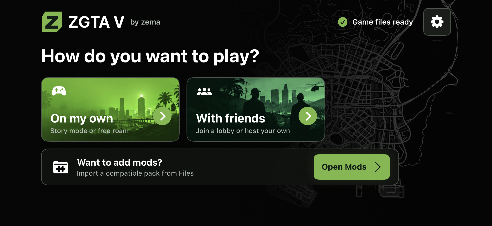
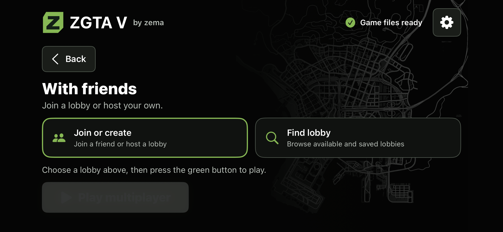
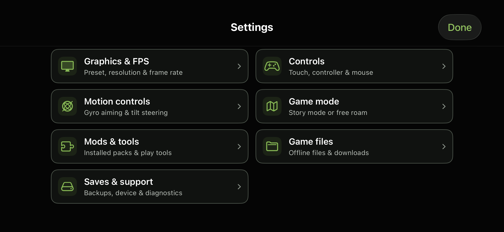
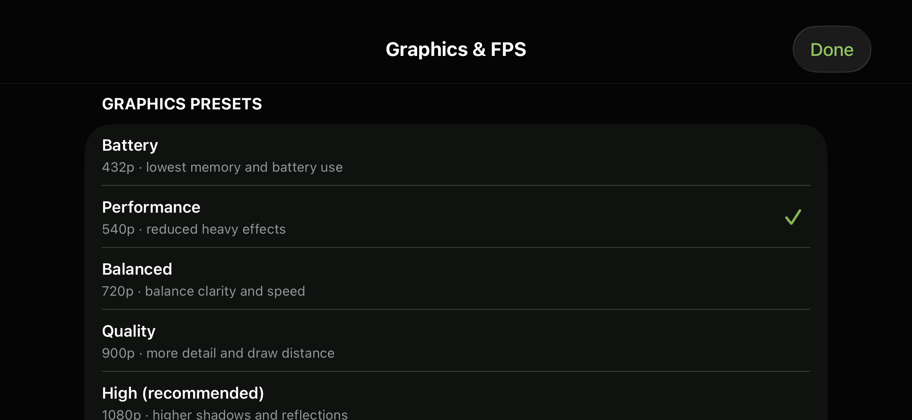

# ZGTA 5 interface previews

[Downloads and guides](../README.md) · [Browser](#browser--mac-launcher) · [iOS](#ios-app)

## Browser / Mac launcher

**Browser / Mac 1.2.** These actual Chrome captures from
1 November 2026 show the native-style black and green surfaces and monochrome
Los Santos map. Desktop navigation and button placement are retained. This
design is included in the public 1.2 browser/Mac downloads.
The Mac app uses the browser launcher. These pictures show layout, not measured
performance or Windows, Linux or Android execution.

### Story mode

Choose Story mode or Free Roam from the menu, then adjust the launch setup.
The main navigation also leads to multiplayer, mods, graphics, controls, saves
and support. The selected preset, resolution and FPS are example settings.

### Graphics

Graphics presets provide a starting point. Resolution and frame rate have
separate controls on the same integrated page.

### Controls

Keyboard, mouse, controller and targeting options stay inside the launcher's
main navigation.

### Mods

The Mod Manager is an integrated launcher page. This preview shows its upper
section with an empty demonstration mod folder; the vehicle catalog and other
play tools continue below. Spawning becomes available after the game world
loads, and vehicles need matching assets.

### Saves

Story, Free Roam and multiplayer backups stay on one page. No save files were
opened or changed for this capture.

### Support

Files, connection help and local diagnostics use the same navigation and map
background. The displayed hardware values describe the capture machine only.

[Earlier Build 107 browser screenshots](INTERFACE-PREVIEWS-107-ARCHIVE.md)
are retained as a dated archive.

## iOS app

These native iOS 26.3 Simulator captures use the iPhone 15 Pro profile and the
production HomeView, SettingsViewController and supporting UIKit sources from
Build 107. This layout remains unchanged in the current Build 109 downloads;
the images retain the signed application's earlier ZGTA V branding. The same
screens were also checked on the smaller iPhone SE 2020 profile. This screen-only
harness starts no game engine; file readiness and hardware values are fixtures.
These images show the native layout, not measured phone performance.

### Home

### With friends

### Settings

### Graphics

